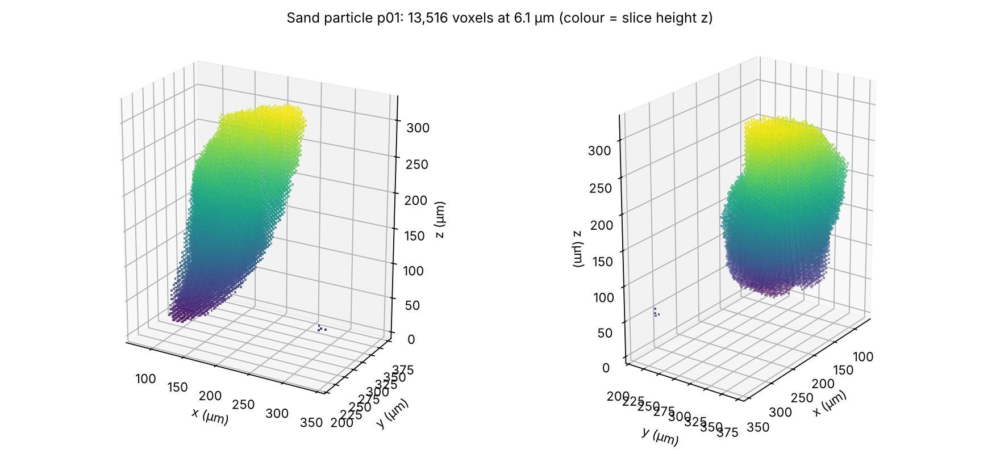
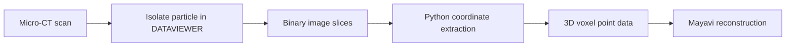
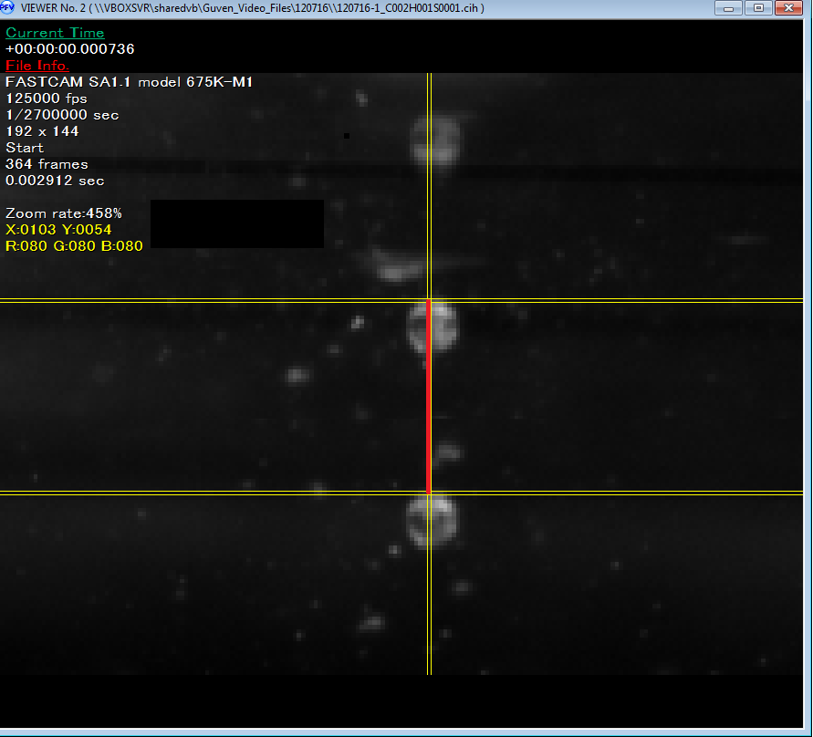

# Microparticle Impact and Fracture Research

**Scientific computing · Experimental mechanics · 3D image reconstruction**

Research work by Zachary Ratliff at Virginia Commonwealth University (VCU), in collaboration with NASA Marshall Space Flight Center, investigating erosion of optical glass substrates caused by high-speed sand and glass microparticle impacts.



*Sand particle `p01` reconstructed from its micro-CT slices: 13,516 voxels at 6.1 µm. Rendered in 2026 from the original 2016 point data in [p01.txt](p01.txt) with [render_particle.py](render_particle.py).*

## Engineering problem

Microparticle impact experiments produce high-speed video and microscopy data. To support the study of particle geometry and impact behavior, I developed Python-based processing and visualization workflows for reconstructing microscopic particles from CT image slices and contributed to high-speed video analysis.

## My contributions

- Analyzed high-speed video to measure particle velocities before and after impact.
- Isolated individual sand particles from micro-CT image stacks using DATAVIEWER.
- Converted binary image slices into three-dimensional voxel coordinates using custom Python scripts.
- Reconstructed individual particle geometries in Mayavi; manually removed overlapping regions from neighboring particles when needed.

## Computational workflow



Each white pixel represents a material point in a binary slice. Python extracts its two-dimensional coordinates and associates them with the slice index, producing a three-dimensional point representation for visualization.

The accompanying [technical report](Reconstruction%20of%20Microscopic%20Particles%20from%20CT-Scan.pdf) documents the scanning, segmentation and reconstruction method in greater detail.

## Example result

One particle's data is included, so the reconstruction step can be checked directly:

| Quantity (particle `p01`) | Value |
| --- | --- |
| Occupied voxels | 13,516 |
| Voxel edge (scan step) | 6.1 µm |
| Volume (voxels × 6.1³) | 3.07 × 10⁶ µm³ |
| Equivalent sphere diameter | ≈ 180 µm |
| Bounding box | 268 × 171 × 305 µm |

```sh
pip install numpy matplotlib
python3 render_particle.py p01.txt images/p01_reconstruction.png
```

The script prints the voxel count, volume and equivalent diameter and writes the figure above. The few isolated voxels near the origin of the plot are in the source data: residue of the manual slice clean-up described in the report.

## High-speed video measurement



*A frame from the 125,000 fps recording, with a particle's pre-impact travel marked for the velocity measurement. Velocity is that distance divided by the elapsed frame time. The per-shot measurements (particle size, pre- and post-impact velocity, kinetic energy, pit and crack dimensions) are in the [spreadsheet](images/Zachary-120716-1-update03082017.xlsx).*

## Repository guide

| Resource | Purpose |
| --- | --- |
| [Technical report (PDF)](Reconstruction%20of%20Microscopic%20Particles%20from%20CT-Scan.pdf) | Original reconstruction report |
| [Text write-up](writeup_dropdown.md) | Description of the CT processing method |
| [analysis1.py](analysis1.py) | Image-slice coordinate extraction (original, Python 2) |
| [2visualize.py](2visualize.py) | Mayavi-based 3D visualization (original, Python 2) |
| [render_particle.py](render_particle.py) | Python 3 re-render of a point file, added in 2026 |
| [p01.txt](p01.txt) | Example voxel point data |
| [images/](images/) | High-speed video frames, the per-shot measurement spreadsheet and the reconstruction figure |

## Related publication

This project contributed to research reported in:

*Erosion of Optical Glass Substrates Due to Sand and Sphere Microparticles*, AIAA (2018). [DOI: 10.2514/6.2018-0647](https://doi.org/10.2514/6.2018-0647).

## Status and reproducibility

This repository preserves historical research materials and scripts. The scripts are not presented as a maintained, validated software package or a complete reproduction of the published experiment; they illustrate the original scientific computing workflow. The two original scripts are Python 2 and read from hardcoded input folders, so they do not run as they are; `render_particle.py` is the only part that runs from a fresh clone, and it covers the visualization step only. The technical report provides the best starting point for understanding the method.

**Technologies:** Python, Mayavi, micro-CT, SEM, high-speed imaging, image processing, voxel reconstruction, experimental mechanics.

**Author:** Zachary Ratliff · [GitHub profile](https://github.com/zach-r-vid)
