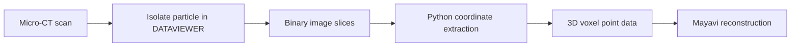

# Microparticle Impact and Fracture Research

**Scientific computing · Experimental mechanics · 3D image reconstruction**

Research work by Zachary Ratliff at Virginia Commonwealth University (VCU), in collaboration with NASA Marshall Space Flight Center, investigating erosion of optical glass substrates caused by high-speed sand and glass microparticle impacts.

## Engineering problem

Microparticle impact experiments produce high-speed video and microscopy data. To support the study of particle geometry and impact behavior, I developed Python-based processing and visualization workflows for reconstructing microscopic particles from CT image slices and contributed to high-speed video analysis.

## My contributions

- Analyzed high-speed video to measure particle velocities before and after impact.
- Isolated individual sand particles from micro-CT image stacks using DATAVIEWER.
- Converted binary image slices into three-dimensional voxel coordinates using custom Python scripts.
- Reconstructed individual particle geometries in Mayavi; manually removed overlapping regions from neighboring particles when needed.

## Computational workflow

Each white pixel represents a material point in a binary slice. Python extracts its two-dimensional coordinates and associates them with the slice index, producing a three-dimensional point representation for visualization.

The accompanying [technical report](Reconstruction%20of%20Microscopic%20Particles%20from%20CT-Scan.pdf) documents the scanning, segmentation and reconstruction method in greater detail.

## Repository guide

| Resource | Purpose |
| --- | --- |
| [Technical report (PDF)](Reconstruction%20of%20Microscopic%20Particles%20from%20CT-Scan.pdf) | Original reconstruction report |
| [Text write-up](writeup_dropdown.md) | Description of the CT processing method |
| [analysis1.py](analysis1.py) | Image-slice coordinate extraction |
| [2visualize.py](2visualize.py) | Mayavi-based 3D visualization |
| [p01.txt](p01.txt) | Example voxel point data |
| [images/](images/) | Experimental analysis materials |

## Related publication

This project contributed to research reported in:

*Erosion of Optical Glass Substrates Due to Sand and Sphere Microparticles*, AIAA (2018). [DOI: 10.2514/6.2018-0647](https://doi.org/10.2514/6.2018-0647).

## Status and reproducibility

This repository preserves historical research materials and scripts. The scripts are not presented as a maintained, validated software package or a complete reproduction of the published experiment; they illustrate the original scientific computing workflow. The technical report provides the best starting point for understanding the method.

**Technologies:** Python, Mayavi, micro-CT, SEM, high-speed imaging, image processing, voxel reconstruction, experimental mechanics.

**Author:** Zachary Ratliff · [GitHub profile](https://github.com/zach-r-vid)
